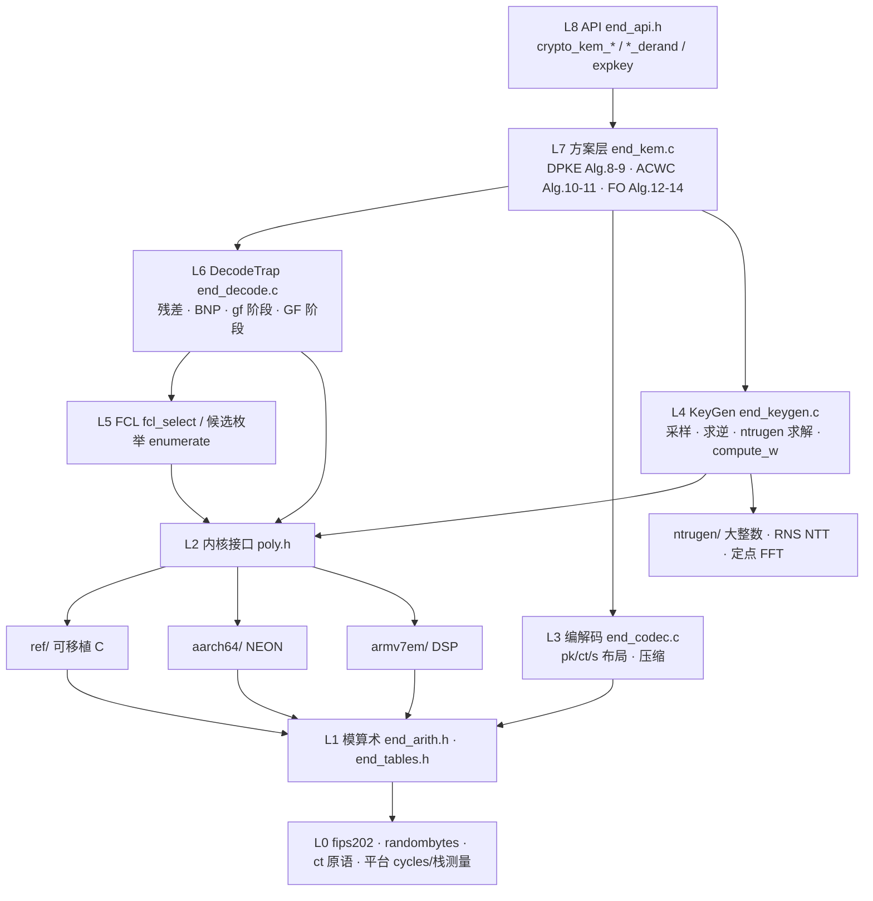

# END KEM ARM 实现 · 详细设计文档

> 对象：论文 *How Compact Can NTRU Encryption Be?*（ePrint 2026/1715）中的 END-512 / END-1024 KEM。
> 参考实现：`https://github.com/Icarid-Liu/Explore_NTRU_Decryption` @ `dde0a77`（`END KEM/END-{512,1024}/END-*-257-C/`）。
> 平台：Cortex-A（AArch64 NEON）与 Cortex-M（ARMv7E-M / ARMv8-M Mainline + DSP）。
> 本文中的"参考实现"均指上述提交；"论文"指 PDF 的章节/算法编号；"设计任务书"指 `fable_prompt_END_ARM_design.md`。

---

## 1. 结论摘要与首要决策

### 1.1 结论

- 三个后端共用方案层。END-1024 使用参考实现的 60 组 KAT。END-512 用连续 SHAKE256 采样，使用 100 组新 KAT 验证 KeyGen，并用 100 组参考向量验证旧密钥的封装和解封装。内核自检、随机往返、隐式拒绝及 wrap 注入的覆盖范围见 [测试报告](TEST_REPORT.md)。
- Decaps 的动态指令数（QEMU 插件统计，END-512，展开密钥）：AArch64 可移植 C 839 k → NEON 438 k（1.9×）；Cortex-M4 可移植 C 3.02 M → DSP 1.98 M（1.5×）。主机 x86-64 可移植 C：Encaps 35 k cycles、Decaps 158 k cycles（展开密钥）/ 240 k（紧凑密钥）、KeyGen 3.7 M cycles。详见 `PERFORMANCE.md`。
- 解码器按论文语义并采用设计任务书 §5 的修正（V2 符号、V5 加倍域），**不是**逐位复刻参考实现的解码器；诚实密文不出现 wrap，因此不影响 KAT 兼容。对参考实现的三个疑点给出了实验证据（§11 DR-07/08/11）：END-1024 参考实现 3.5% 的解封装失败来自 `poly_norm2` 的 int16 溢出；gf 阶段 FCL 边界误用 128（应为 257）；候选修正项符号相反。

### 1.2 决策

| 编号 | 决策 | 选择 | 理由 |
|---|---|---|---|
| **D0** 规范基准 | 线格式兼容与内部修正 | NTRU 求解器、`w` 的定点计算、压缩、比特布局、编码和哈希沿用参考实现。END-512 采样使用连续 SHAKE256。解码在加倍域实现并修正符号 | KAT 验证生成及导入密钥的行为，golden model 覆盖 wrap 路径 |
| **D1** Cortex-M KeyGen | **支持**，但默认建议主机侧生成 | 求解器实测只需 22·n 字节 scratch（canary 实测，§5.4），静态分配 11 KB（512）/ 22 KB（1024）；代码 ~60 KB；QEMU 指令数 28.8 M（512）/ 82 M（1024），168 MHz M4 上约 0.2–0.6 s | 可行且已在 QEMU-M4 上通过 KAT；但耗时与 RAM 远大于 Encaps/Decaps，产品部署建议注入私钥 |
| **D2** 私钥形态 | 紧凑 sk 为线格式 + 运行期展开 `end_expkey` | sk = k‖pk‖f‖g‖F‖G‖w（3618/7235 B）；`expkey_from_sk` 预计算 NTT 形式（19 KB / 38 KB RAM）；Cortex-M 使用 `END_STATIC_EXPKEY` 静态单实例 | 展开节省约 1/3 的 Decaps 指令数（AArch64 616 k→438 k）；Flash 中只存紧凑形式 |
| **D3** NTT 域排列 | NTT-257 使用参考实现排列（= pk 线格式）；NTT-3329/12289 各后端目前也用同一排列 | 基乘法在 NEON 中通过寄存器内转置实现，无需改变内存排列 | 跨后端中间值可直接比对，测试简单；未来 NEON 层合并可改内部排列（仅 3329/12289） |
| **D4** intrinsics vs `.S` | 本轮全部用 C intrinsics / 内联汇编包装 | NEON：`arm_neon.h`；Cortex-M：`dsp.h` 中的 SMULxx/SMLAxx/PKH/SADD16 内联汇编 | 可维护、可被编译器调度；手写 `.S`（层合并、寄存器驻留）列为后续优化（§13） |

每一处与论文/参考实现的偏离记录在 §11 的 DR 表中。

---

## 2. 目标平台确认表

| 平台 | 工具链 | 验证环境 | 测量方式 |
|---|---|---|---|
| Cortex-A（AArch64, ASIMD） | `aarch64-linux-gnu-gcc` 13.3，`-O3 -march=armv8-a` | `qemu-aarch64` 8.2（功能）、自建 QEMU 9.1 + `libinsn` 插件（动态指令数） | 真机：`bench/cycles.c` 读 `CNTVCT_EL0`，或 `-DEND_AARCH64_PMU` 读 `PMCCNTR_EL0`（需内核开放） |
| Cortex-M4F（ARMv7E-M） | `arm-none-eabi-gcc` 13.2，`-mcpu=cortex-m4 -mfloat-abi=hard -mfpu=fpv4-sp-d16 -O3`，newlib-nano + rdimon 半主机 | `qemu-system-arm -M mps2-an386`（功能 + 插件指令数） | 真机：DWT CYCCNT（`bench/cycles.c`），栈涂色（`platform/cortex-m/startup.c`） |
| Cortex-M33（ARMv8-M Mainline + DSP） | 同上，`-mcpu=cortex-m33 -mfpu=fpv5-sp-d16` | `qemu-system-arm -M mps2-an505` | 同上 |
| 主机 x86-64 | gcc 13，`-O3 -march=native` | WSL Ubuntu 24.04 | `rdtsc` |

与设计任务书差异：Cortex-M4 和 M33 共用 `src/armv7em/`（Thumb-2 + DSP），两者差异只在编译标志与 QEMU 机型；真机 pqm4 集成未在本轮完成（接口已按 pqm4 的 `crypto_kem_*` 风格准备）。

---

## 3. 参数与常量总表

| 符号 | END-512 | END-1024 | 出处 |
|---|---|---|---|
| n, logn | 512, 9 | 1024, 10 | 论文 Table 2 |
| q, Q | 257, 12289 | 257, 12289 | Table 2；`end_params.h` |
| qQ, 2qQ | 3158273, 6316546 | 同 | 解码器模数（V5） |
| 辅助 NTT 素数 p₃ | 3329 | 3329 | 本设计（DR-05）：s̄′ 与 r·f 的精确计算，范围 ±1664 |
| 叶子次数 L（NTT-257/3329） | 4 | 8 | V6：x^n+1 在 mod 257/3329 下分裂成 128 个 L 次因子 |
| 压缩基 d_e；压缩/解压 | 64；c=⌊255x/1024⌋, x′=4c+3 | 90；c=⌊717x/2048⌋, x′=⌊731c/256⌋+2 | 参考实现 `poly.c`（任务书 §6-4） |
| 中心化偏移 δ（μ̄=2μ′−δ） | 1 | 0 | 参考实现 `pke.c`（V5） |
| f, g 分布 | i.i.d. 三元，P(±1)=9/64 | i.i.d. 三元，P(±1)=3/32 | 参考实现采样器（DR-01） |
| ‖F‖∞, ‖G‖∞ 上界 | 31 | 31 | 求解器 profile `coeff_FG_limit`（§5.2） |
| γ（w 的权重） | 6 | 3 | 参考实现 `compute_w`（论文写 4/3，DR-03） |
| w 范围 | \|w\| ≤ 2^15（int16） | 同 | `compute_w` 的 `lim2=8` 检查 |
| (B_gf,0, B_gf,1) / (B_GF,0, B_GF,1) | (2,1)/(2,1) | (2,1)/(2,1) | Table 2；1024 的 GF 阶段论文为 (1,1)，参考用 2 重（DR-09） |
| m₀（FCL 输出规模） | 2 / 2 | 2 / 2 | 论文未给；参考取 top-2（DR-06）；编译期 `END_M0_GF`, `END_M0_GF2` 可调 |
| 候选族大小 | 9 / 9 | 9 / 9 | 1+Σ_j C(m₀,j)(2B₁)^j，固定公开 |
| H1 = H2 | SHA3-256 | SHA3-512 | 参考 `kem.c`/`pke.c`（DR-10） |
| K | SHA3-256(m‖ct) | SHA3-256(m‖ct) | 参考 `kem.c` |
| \|M\| | 32 B | 64 B | n/2 bits |
| pk / ct / sk / ss | 514 / 384 / 3618 / 32 | 1027 / 832 / 7235 / 32 | Table 2；sk 为本设计紧凑格式（§8） |
| NTT-257 twiddle | 3^{brv₇(k)} | 同 | 由参考实现表 `f_257` 反推（ω=3） |
| NTT-3329 twiddle | 17^{brv₇(k)} | 同 | Kyber 的 ζ=17 |
| NTT-12289 twiddle | ψ^{brv(k)}, ψ=11^{(q−1)/2n} | 同 | `scripts/gen_tables.py` |
| Montgomery R | 2^16 | 2^16 | 257：R≡1，无因子；3329/12289：标准 |

所有表格由 `scripts/gen_tables.py` 生成到 `src/common/end_tables.h`（含逆 twiddle、Montgomery 形式、n^{-1}、CRT 常数）。

---

## 4. 模块依赖与目录



目录与后端选择：

```
src/common/   end_params.h end_api.h end_internal.h end_arith.h end_tables.h poly.h
              end_codec.c end_decode.c end_kem.c end_keygen.c fips202.[ch] randombytes.c
              ntrugen/  ntru.c module_p.c big_integer.c fixed_point.c poly_big.c (+shim 头)
src/ref/      ntt257.c ntt3329.c ntt12289.c polyvec.c baseinv257.c
src/aarch64/  ntt257.c ntt3329.c ntt12289.c polyvec.c neon_common.h
src/armv7em/  ntt257.c ntt3329.c ntt12289.c polyvec.c dsp.h
platform/cortex-m/  Makefile link.ld startup.c randombytes_m.c
```

`Makefile` 的 `KERNELS := ntt257 ntt3329 ntt12289 polyvec baseinv257`：对每个内核名，若 `src/$(BACKEND)/<名>.c` 存在则使用它，否则回退到 `src/ref/`（例如 `baseinv257` 只有 ref 实现，所有后端共用）。符号以 `end512_` / `end1024_` 前缀命名空间化（`END_NS`），两套参数可链接进同一程序。

---

## 5. 数学依据（golden model 复验）

记号与设计任务书 §5 一致：c′ 为解压密文；s̄ = 2s − 𝟙，μ̄ = 2μ′ − δ𝟙；G_Q = QG − wg，F_Q = QF − wf。

- **V1/V5（BNP 恒等式，加倍域）**：
  c₁ = g s̄ + f μ̄ mod± 2q，C₂ = (Q·c₂ − w c₁) mod± 2qQ，其中 c₂ ≡ G s̄ + F μ̄ (mod 2q)。则
  (μ̄′, −s̄′) = (1/qQ)·(C₂, −c₁)·[[g, f],[G_Q, F_Q]] = (μ̄, −s̄) + 2e₁(G,F) − 2e₂(g,f)，除法精确。
  `golden/test_wraps.py::check_identities` 对每个注入实例验证该式（含真实 e₁、e₂）。
- **V2（候选修正的符号）**：对候选 ẽ，r = ⌊(C₂ − 2qwẽ)/(2qQ)⌉，
  (μ̄″, −s̄″) = (μ̄′, −s̄′) − 2ẽ(G,F) − 2r(g,f)，即 **s̄″ = s̄′ + 2ẽF + 2rf**；GF 阶段 **s̄ = s̄″ − 2ẽ_GF f**。
  论文 Alg.6 第 7 步印刷为 "+"；参考实现在 {0,1} 域中计算 `sp − rf − ẽF`（符号相反，DR-08）。golden 用例 "S6" 证明参考符号对真候选不能恢复 s。
- **V3（避免 mod 12289 域中除以 qQ）**：s̄′ 的分子 c₁F_Q − C₂f 被 qQ = 257·12289 整除，在 mod 12289 域中恒为 0，故**不能**用 12289 做这一步除法；需要与 qQ 互素的模。参考用 769；本设计用 3329（DR-05）：|s̄′| ≤ 1 + 2·2·31 + 2·2 = 129，|r·f| ≤ 6·‖f‖₁ ≤ 864（r ∈ [−6,6]，由 |2qw| ≤ 2.7·2qQ 推出），均 < 1664。
- **V4**：`zint_bezout` 要求两个结数均为奇数 ⇒ 参考 KeyGen 生成的密钥恒有 Σf、Σg 为奇数（2000 组 KAT 实测 100%）。推论：END-512 的 c₁ 恒为偶数，END-1024 的 c₁ 恒为奇数。这解释了参考实现在 w·c₁ 的 CRT 中只取偶代表元（512）/ 只看 Σw 奇偶（1024）为何"恰好正确"（DR-04）。本设计在 `expkey` 中存 `pwc1 = p₁·(Σw mod 2)`，对任意密钥都正确。
- **V6/V7**：x^512+1 在 mod 257/3329 下分裂为 128 个 4 次因子（7 层不完全 NTT）；257 是 Fermat 素数，R=2^16≡1 使 Montgomery 无因子、约简为移位。**注意**：int16 回绕对 mod 257 并非无害（65536 ≡ 1 而非 0）——本实现采用显式范围纪律（§5.1）。

### 5.1 数值范围表（全部中间量）

| 量 | 理论界 | 存储 | ref | aarch64 (NEON) | armv7em (DSP) |
|---|---|---|---|---|---|
| c′ | [0,256] | int16 | — | — | — |
| NTT-257 前向：输入经 red257→[0,257)；每层 ±257 | < 8·257 = 2056 | int16 | 无中间约简 | 同 | 同（SADD16 回绕不发生） |
| NTT-257 逆向：GS 和 | 每层 red257 → [0,257)；差 ∈ (−257,514) | int16 | 每层约简 | 每层约简 | 每层约简 |
| 基乘法 257：lo+ζ·hi | < 2^20 + 2^28 | int32 | `red257_32` | 32→16 Fermat 两步 | `red257_32` |
| c₁, c₂ | [−257, 256] | int16 | 奇偶提升 `lift_center_parity` | 同 | 同 |
| w·c₁ (mod 257 / mod 12289) | [0,257) / [0,12289) | int16 | NTT-257 / NTT-12289 | 同 | 同 |
| Garner CRT：d·257⁻¹ | d ∈ (−257,12289)，d·3666 < 2^26 | int32 | `mont12289` | 标量 | 标量 |
| u = w c₁ mod qQ，u′ 奇偶提升 | [0,qQ) / [0,2qQ) | int32 | — | — | — |
| C₂ | [−qQ, qQ) | int32 | `center_2qqp`（输入 (−3qQ,qQ)） | 同 | 同 |
| NTT-3329 前向：输入 Barrett→\|a\|≤1665；每层 +3329 | < 1665+7·3329 = 24968 | int16 | 无中间约简 | 同 | 同 |
| NTT-3329 逆向 | 和每层 Barrett（ref/NEON）；DSP 版每 3 层一次（界 ≤ 13316，差 ≤ 26632） | int16 | | | |
| 基乘法 3329：lo, hi | < 8·3329² < 2^27；hi 先 Montgomery 到 16 位再乘 ζR | int32 | `red3329_32` | `neon_montred32` ×2 + R² 修正 | 同 ref |
| s̄′ | \|·\| ≤ 129（真值） | int16（mod 3329 中心化） | 精确 | 精确（`neon_center_exact`） | 精确 |
| r | [−6, 6] | int16 | `round_div_2qqp`（Barrett，输入 \|v\|<2^27） | 同 | 同 |
| r·f | \|·\| ≤ 864 | int16 | 精确 | 精确 | 精确 |
| s̄″ = s̄′+2ẽF+2rf | \|·\| ≤ 129+124+1728 | int16 | | | |
| ‖s̄″‖² | ≤ n·2^22 | uint64 | | `vmull`+64 位累加 | `SMLALD` |
| C₂ − 2qwẽ − 2qQr | \|2qwẽ\| ≤ 2·257·2·2^15 < 2^26 | int32 | | | |
| NTT-12289 前向 | 输入 Barrett ≤ 6145；每两层约简 | int16 | 保持 [0,q) | 每两层 Barrett | 每两层 Barrett |
| NTT-12289 逆向 | 和每层约简；差 ≤ 2q | int16 | | | |
| w | \|w\| ≤ 2^15（边界 32768 不可表示，DR-03） | int16 | | | |

### 5.2 KeyGen 侧的数值保证

- `SOLVE_END_257_{512,1024}` profile：`coeff_FG_limit = 31` ⇒ ‖F‖∞, ‖G‖∞ ≤ 31（int8 存储有余量）。
- `compute_w`：`lim1` 检查被除数、`fxr_lt(..., 30−logn)` 检查商、`lim2 = 8` 检查 |w/2^12| ≤ 8 ⇒ |w| ≤ 2^15。w·R(=20478) 的归一化用 `/20478`（恒整除）。
- scratch：canary 实测（`test/test_keygen_tmp.c`）两种参数集均恰好使用 22·n 字节；`END_KEYGEN_TMPBYTES = 22n + 16`。

---

## 6. 逐层模块设计

### L0 平台与安全基元

- END-512 KeyGen 通过 `shake256_squeeze` 连续读取拒绝密钥和采样字节。END-1024 保留参考向量的块读取规则（DR-13）。
- 随机版 KeyGen 和 Encaps 检查 `randombytes` 返回值。Cortex-M 的 `END_TEST_DRBG` 由 QEMU 测试配置启用，`REAL_BOARD=1` 依赖板级 `platform_entropy`。
- 常数时间原语 `end_arith.h`：`ct_lt_u32/u64`（无分支比较）、`ct_mask_lt_u32`、`ct_eq/is_zero`、`ct_sel_i32`。
- 计时：`bench/cycles.c`（rdtsc / CNTVCT / PMCCNTR / DWT）；栈涂色与 `platform_stack_used()`（`startup.c`）。

### L1 模算术规格（`end_arith.h`）

| 函数 | 规格 | 实现 |
|---|---|---|
| `mont257(a)` | a·2⁻¹⁶ ≡ a (mod 257)，\|a\|<2^28 → int16 | `mont_reduce16`（无 UB：低 16 位用无符号乘） |
| `red257(x)` | 任意 int16 → [0,257) | lo−hi ∈ [−127,383]，两次条件修正（原单次修正版本在 x=−257 时输出 257，已由穷举测试发现并修复） |
| `barrett3329 / canon3329` | 任意 int16 → \|r\|≤1664 / [0,3329) | v=20159, 2^26 |
| `red3329_32(a)` | \|a\|<2^27 → [0,3329) | M=⌈2^39/3329⌉，两次修正 |
| `barrett12289 / canon12289` | 任意 int16 → \|r\|≤6145 / [0,12289) | v=5461 |
| `round_div_2qqp(v)` | ⌊(v+qQ)/(2qQ)⌋，\|v\|<2^27 | M=⌈2^50/2qQ⌉ 的 64 位乘高 + 两次修正；随机 2×10⁶ 点 + 边界值测试 |
| `center_2qqp(v)` | (−2·2qQ, 2·2qQ) → [−qQ, qQ) | 两次掩码加减 |

所有函数经 `test/test_kernels.c` 对 int16 全域穷举、int32 随机 2×10⁶ 点验证。

### L2 内核接口（`poly.h`）

| 函数 | 输入 | 输出 |
|---|---|---|
| `poly_ntt257(a)` | 任意 int16 | [0,257)，参考排列 |
| `poly_intt257(a)` | 任意 int16（NTT 排列） | [0,257) |
| `poly_basemul257(r,a,b)` | [0,257) | [0,257)，叶子乘积 |
| `poly_baseinv257(r,a)` | [0,257) | 0=可逆；范数下降法求逆（控制流固定） |
| `poly_ntt3329 / intt3329 / basemul3329` | 任意 int16 / 任意 / [0,3329) | [0,3329) / 中心化 \|·\|≤1664 / [0,3329) |
| `poly_ntt12289 / intt12289 / pointwise12289` | 任意 int16 / 任意 / [0,12289) | [0,12289) / 中心化 \|·\|≤6144 / [0,12289) 真乘积（无 Montgomery 因子） |
| `poly_rot16(r,a,k)` | k 秘密 | x^k·a，负循环，地址公开 |
| `poly_sqnorm16` / `poly_cmov16/32` / `fcl_select(idx,m0,scores)` | | 精确 64 位 / 掩码拷贝 / 常数时间 top-m₀（平局取小下标） |

### L3 编解码（`end_codec.c`）

见 §8。解码均为全函数（任意字节串 → 范围内系数）且常数时间（基数转换用 16 位 limb 的倒数乘法，不用除法指令、不用 128 位整数）。

### L4 密钥生成（`end_keygen.c`）

1. `shake256_absorb_once(seed)`；`shake256_squeeze(k)`；
2. 循环：`ternary_sample(f)` 直到 NTT-257 域可逆；`ternary_sample(g)` 同；h = g·f⁻¹（NTT 域）；`pk_encode`；
3. `solve_NTRU(prof, logn, g, f, tmp)`（参数顺序交换，得 g·F − f·G = q，输出 tmp 前 2n 字节为 G‖F）；失败则重采样；
4. `compute_w`（原样移植，权重 `END_GAMMA2`）；失败则重采样；
5. sk = k‖pk‖f‖g‖F‖G‖w（w 由 tw/20478 得到）。

### L5 FCL（`fcl_select` + `enumerate`）

- 打分：gf 阶段 d_i = 257 − |c₁,i|（c₁ ∈ [−257,256]），GF 阶段 d_i = qQ − |C̃₂,i|。
- `fcl_select`：维护长度 m₀ 的有序表，每个元素固定做 m₀ 次掩码交换；平局时先出现（小下标）者优先——与 golden 的 `(score, index)` 排序一致。
- 候选枚举顺序（固定公开）：零候选；单项 ±x^{S[k]}（k 升序，先 −1 后 +1）；双项 (k₀<k₁)×{(−,−),(−,+),(+,−),(+,+)}。

### L6 DecodeTrap（`end_decode.c`）

```
cn = NTT257(c′)
c1 = lift(2·INTT(cn∘NTT(f)) − (g+δf)𝟙, p1)        c2 = lift(2·INTT(cn∘NTT(F)) − (G+δF)𝟙, p2)
u257 = 2·INTT(cn∘NTT(wf)) − w(g+δf)𝟙 mod 257      u12289 = INTT12289(NTT12289(c1)∘NTT12289(w))
u = Garner(u257, u12289) ∈ [0,qQ);  u′ = u + qQ·[parity(u) ≠ pwc1];  C2 = center(Q·c2 − u′)
s̄′ = INTT3329( (NTT3329(c1)∘NTT3329(F_Q) − NTT3329(C2 mod 3329)∘NTT3329(f)) · (qQ)⁻¹ )
--- gf 阶段 ---
S = fcl_select(257 − |c1|, m0);  wrot[k] = x^{S[k]}·w;  Frot[k] = x^{S[k]}·F
best = s̄′, bestC2 = C2, bestScore = ‖s̄′‖²
for 每个非零候选 (σ0,k0,σ1,k1):
    r_i = round_div_2qqp(C2_i − 514·(σ0 wrot[k0]_i + σ1 wrot[k1]_i))
    rf  = INTT3329(NTT3329(r)∘NTT3329(f))
    s̄″  = s̄′ + 2(σ0 Frot[k0] + σ1 Frot[k1]) + 2 rf ;  score = ‖s̄″‖²
    better = score < bestScore (ct);  cmov(best, s̄″);  cmov(bestC2, C2 − 514·we − 2qQ·r)
--- GF 阶段 ---
S = fcl_select(qQ − |bestC2|, m0);  frot[k] = x^{S[k]}·f
for 每个候选（含零）: s̄ = best − 2(σ0 frot[k0] + σ1 frot[k1]);  pass = AND_i (s̄_i² == 1)
    take = pass & ~found;  cmov(out, s̄);  found |= pass
return found  (0 ⇒ 解密失败，上层通过 FO 隐式拒绝)
```

内核调用计数（END-512，m₀=2，每次 `decode_trap`）：NTT-257 前向 1、基乘法 3、逆向 3；NTT-12289 前向 1、逐点 1、逆向 1；NTT-3329 前向 2+8、基乘法 2+8、逆向 1+8；`rot16` 6；`sqnorm` 9；`cmov16` 8+9；`fcl_select` 2。`expkey_from_sk`：NTT-257 前向 8、逆向 3、基乘法 5；NTT-12289 前向 1；NTT-3329 前向 3、逆向 1、基乘法 1。`pke_encrypt`（Encaps 与重加密各一次）：NTT-257 前向 1、基乘法 1、逆向 1 + SHA3 一次。

### L7 方案层（`end_kem.c`）

- DPKE.Encrypt：c = compress(INTT(NTT(h)∘NTT(s)))；
- PKE（ACWC）：m′ = m ⊕ H1(r)，s 的比特布局 `s[i·MB+j] = m′[j]_i`，`s[n/2+i·MB+j] = r[j]_i`；
- KEM（FO⊥̸）：r = H1(m)（H2=H1）；K = SHA3-256(m‖ct)；Decaps 重加密后按**字节**比较密文（参考比较解码后的系数数组，DR-15），失败时 m ← k（掩码选择），K = SHA3-256(k‖ct)。

### L8 API 与配置开关

| 宏 | 作用 |
|---|---|
| `END_N` | 512/1024 |
| `END_M0_GF`, `END_M0_GF2` | FCL 输出规模（默认 2，允许 1–8，候选数组按两阶段的较大容量分配） |
| `END_FULL_SCORE` | 预留：gf/GF 阶段加入 μ̄ 项（需 G、G_Q 的 NTT-3329 形式，`expkey` 已含字段） |
| `END_STATIC_EXPKEY`, `END_STATIC_KEYGEN_TMP` | Cortex-M：用静态缓冲代替栈（19/38 KB 与 11/22 KB） |
| `END_RANDOMBYTES_EXTERNAL` | 裸机：平台提供 `randombytes` |
| `END_KEYGEN_TRACE` | 调试：KeyGen 过程打印 |

---

## 7. 热点内核设计（NEON 与 Cortex-M 两栏）

| 内核 | ref | aarch64 (NEON intrinsics) | armv7em (DSP 内联汇编) |
|---|---|---|---|
| **K1 NTT-257 前向** | 7 层 CT，`mont257` 乘 twiddle（无因子），终末 `red257` | 输入 `neon_red257`（6 条）；len ≥ 8 整向量蝶形：`neon_montmul`（MUL/SQDMULH×2/SHSUB，4 条）+ ADD/SUB；len = 4（512）用 `vzip1q/vzip2q_s64` 把两向量拆成 (lo,hi) 做同向量蝶形，twiddle 向量 `[z0×4, z1×4]`；终末 red257 | 每 32 位字两系数：`dsp_montmul_pair`（SMULBB/SMULTB×2, SMLABB×2, PKHTB），`SADD16/SSUB16`；len ≥ 2 的所有层统一处理（len=4 时半块为 2 个字） |
| **K1 NTT-257 逆向** | GS，和每层 `red257`，差经 `mont257`，终末 ×128⁻¹ | 同结构；len=4 层先做 | 同结构 |
| **K1 基乘法 257** | 叶子 schoolbook（L=4/8），`red257_32` | 8 叶子 4 向量经 UZP/ZIP 两轮转置成系数主序；`vmull/vmlal` 32 位累加；ζ 向量 `[z0,−z0,z1,−z1,…]`；32→16 两步 Fermat 约简；ZIP 转回。1024（L=8）用 3 级 TRN 的 8×8 转置 | L=4：`SMUAD/SMUADX/SMULxx` 组合（r1=SMUADX(A01,B01)+z·SMUADX(A23,B23) 等）；L=8 用通用循环 |
| **K1 求逆 257**（仅 KeyGen） | 范数下降：a⁻¹ = a(−x)·(a(x)a(−x))⁻¹，递归到标量，Fermat 幂 a^255 | 共用 ref | 共用 ref |
| **K2 NTT-3329** | Kyber 式 Montgomery；前向无中间约简；逆向和每层 Barrett | 同 K1 结构，`neon_barrett`（SQRDMULH/SRSHR/MLS）；终末 `neon_center_exact` 修 Barrett 的 ±1 边界 | 同 K1；逆向每 3 层一次 Barrett（§5.1 界） |
| **K2 基乘法 3329** | hi 先 `mont3329` 到 16 位，×ζR² 再 Montgomery，`red3329_32` | `neon_montred32`（MUL/MOVN/MLSL/SHRN）+ `vmlal(h, ζR)` + R² 修正 | 同 ref |
| **K3 NTT-12289** | 完全 NTT，[0,q) 条件加减 | len ≥ 8 整向量；len=4/2/1 用 64/32/16 位 lane 的 ZIP/UZP 把蝶形对摆到不同向量；twiddle 向量按层构造（`vzip1q(z,z)`、直接 8 连续）；前向每两层 Barrett、逆向每层 | len ≥ 2 打包；len = 1 在字内做（SMULTB 取高半）；前向每两层 Barrett，逆向每层（差 ≤ 2q 的界） |
| **K4 提升/CRT/舍入** | `lift_center_parity`、Garner（`mont12289(d·257⁻¹R)`）、`round_div_2qqp`、`center_2qqp` | 标量（编译器自动向量化部分循环） | 标量 |
| **K5 压缩/编解码** | 参考格式；基数转换 `ct_divmod_small_u64`（16 位 limb × ⌊2^32/d⌋，每步一次修正） | 标量 | 标量（无 UDIV、无 128 位） |
| **K6 FCL top-m₀** | 有序表 + 掩码交换 | 同 ref（标量；数据依赖链） | 同 ref |
| **K7 常数时间旋转** | log₂n 级桶形：u = x^{2^b}·t，按位掩码选择；地址公开 | 级 < 8 用 `vextq`（跨向量边界）+ `vbslq`；级 ≥ 8 整向量搬移（负循环取反）| 第 0 级用 `PKHBT` 重打包半字；其余级整字搬移，回绕字用 `SSUB16(0,x)` 打包取反 |
| **K8 范数/二元检查/argmin/cmov** | uint64 累加；`acc \|= s²−1`；`ct_lt_u64` | `vmull`+`vpaddlq`（每 4 积宽化一次，任意 int16 精确）；`vbslq` | `SMLALD`；字级掩码 |
| **K9 Keccak** | pq-crystals 标量 C | 同（FEAT_SHA3 版本列为后续工作） | 同（可换 XKCP ARMv7-M 汇编） |
| **K10 三元采样** | 参考实现逐字节掩码（无查表） | 共用 | 共用 |
| **K11 KeyGen 大整数/RNS/定点 FFT** | ntrugen 原样 | 共用（31 位模乘由编译器生成 UMULH 序列） | 共用（UMULL/UMLAL） |

### 7.1 NEON 关键指令序列（Montgomery 蝶形）

```
// y, x: int16x8; z: twiddle*R (centred); zq = z*pinv (mod 2^16); pv = p
m  = MUL   y, zq        // a z p^-1 mod 2^16
h  = SQDMULH y, z       // (2 a z) >> 16
l2 = SQDMULH m, pv      // (2 m p) >> 16
t  = SHSUB  h, l2       // (a z - m p)/2^16  ∈ (-p, p)
x' = ADD x, t ;  y' = SUB x, t
```
正确性：2az ≡ 2mp (mod 2^17) ⇒ 两个 floor 之差精确等于 (2az−2mp)/2^16（偶数），halving 精确；饱和仅在 a=z=−32768 时发生（twiddle 中心化排除）。

### 7.2 Cortex-M 关键指令序列（打包蝶形）

```
t0 = SMULBB y, z      ; t1 = SMULTB y, z          // y.lo*z, y.hi*z
m0 = SMULBB y, zq     ; m1 = SMULTB y, zq         // 低 16 位 = y_i z p^-1 mod 2^16
r0 = SMLABB m0, -p, t0; r1 = SMLABB m1, -p, t1    // t - m p（低 16 位为 0）
t  = PKHTB r1, r0, ASR #16                        // [r1>>16 : r0>>16]
x' = SADD16 x, t ; y' = SSUB16 x, t
```
每两个蝶形 11 条 ALU + 4 条访存（约 7–8 cycle/蝶形，M4 估算）；手写汇编层合并可再降至 3–4 cycle/蝶形（§13）。

---

## 8. 字节级编码格式

### 8.1 公钥（514 / 1027 B，与参考 `code.c` 逐位一致）

内容为 NTT-257 域中的 h（参考排列，值 ∈ [0,257)）。每个值 v 按 258 = 86·3 做 CRT 分解：r₈₆ = v mod 86，r₃ = v mod 3。

- 基 86 部分：每 7 个 r₈₆ 组成一个 45 位字（86⁷ < 2^45）。END-512：73 个字（511 个系数）+ 最后一个系数单独 1 字节；END-1024：146 个字 + 末两系数组成 `tmp[146]`。
  - 字 i≡1,2 (mod 3) 整字存入 64 位小端字（移位 19）；字 i≡0 (mod 3) 的低 38 位存入同组 64 位字的空位，高 7 位集中存放：每 24 个字对应 7 个字节（`out[idx+j] = (tmp[i+3j]>>38)<<1 | (tmp[i+21]>>(38+j))&1`）。
  - 512：低位区 384 B（0..383），高位区 384..404，`tmp[72]` 6 B（405..410），末系数 r₈₆ 1 B（411）。
  - 1024：低位区 768 B，高位区 768..809，`tmp[144]`、`tmp[145]` 各 5 B + 共享高位字节（810..822）。
- 基 3 部分：每 17 个 r₃ 组成 27 位字；每 6 个字打包成 5 个 32 位小端字（第 6 个字的 25 位拆成 5×5 位放入前 5 字的高 5 位），顶 2 位汇总到尾部。512：412..511 为 25 个 32 位字，512..513 为尾部；1024：823..1022 为 50 个 32 位字，1023..1026 为尾部（含最后 4 个 r₃）。
- 解码：`v = 87·r₈₆ + 172·r₃ mod 258`，再 `red257`（257 折到 0；参考实现保留 257，本实现规范化到 [0,257)，对合法公钥无差别）。

### 8.2 密文（384 / 832 B）

- END-512：每 4 个 6 位系数 c₀..c₃ 占 3 字节：`b0 = c0 | (c3&3)<<6`，`b1 = c1 | ((c3>>2)&3)<<6`，`b2 = c2 | ((c3>>4)&3)<<6`。
- END-1024：每 8 个 base-90 系数组成 52 位字 Σ c_k·90^k；128 个字按参考 `encode_c` 的布局打入 104 个 64 位小端字（每 5 个字占 4 个 64 位字，第 5 个字的 4×12 位拆入前 4 字高位、顶 4 位汇总到 `res[64]`/`res[101]`，`tmp[125..127]` 特殊处理）。

### 8.3 私钥（本设计，3618 / 7235 B）

`k (MSGBYTES) ‖ pk ‖ f ‖ g ‖ F ‖ G (各 n 字节 int8) ‖ w (n × int16 小端)`。展开形式 `end_expkey`（§6 L8）不序列化。

### 8.4 消息/随机数布局

`s[i·MB + j] = bit i of m′[j]`（i∈[0,8)，j∈[0,MB)），`s[n/2 + i·MB + j] = bit i of r[j]`。

---

## 9. 关键流程

```mermaid
sequenceDiagram
    participant E as Encaps
    participant D as Decaps(ek)
    E->>E: m ← randombytes; r = H1(m); m′ = m ⊕ H1(r); s = layout(m′, r)
    E->>E: c = compress(INTT257(NTT257(h)∘NTT257(s))); ct = ct_encode(c); K = SHA3-256(m‖ct)
    D->>D: c′ = decompress(ct_decode(ct))
    D->>D: decode_trap(ek, c′) → s̄, found   [§6 L6]
    D->>D: (m′, r) = layout⁻¹(s); m = m′ ⊕ H1(r)
    D->>D: ct″ = pke_encrypt(h, m, H1(m)); fail = ct″ ≠ ct (ct 字节比较)
    D->>D: m ← fail ? k : m (cmov); K = SHA3-256(m‖ct)
```

---

## 10. 预算与测量

详见 `PERFORMANCE.md`。摘要（END-512，Decaps 展开密钥）：AArch64 NEON 438 k 指令（可移植 839 k）；Cortex-M4 DSP 1.98 M 指令（可移植 3.02 M）；主机 x86-64 158 k cycles。代码尺寸（Cortex-M4，含测试与 newlib）：test_kat 镜像 text ≈ 88 KB；栈峰值见 `PERFORMANCE.md`（涂色法测得）。

---

## 11. 差异与决策记录（DR）

| DR | 对应 | 内容 | 处理 |
|---|---|---|---|
| DR-01 | §6-1 | f, g 采样采用三元分布（512：6 bit → k<9 为 −1，k>54 为 +1；1024：位与/位差构造 P(±1)=3/32） | 两套参数沿用映射规则，END-512 的 XOF 读取规则见 DR-13 |
| DR-02 | §6-2 | 求解器 ntrugen + profile；调用顺序 `(g, f)` 得 gF − fG = q；输出 G 在前 F 在后；需 22n 字节 scratch | 原样移植；scratch 用量 canary 实测 |
| DR-03 | §6-3 | w 权重 6/3（论文 4/3）；w 用 31 位素数 NTT + 32.32 定点 FFT；`/20478` 去 Montgomery 因子；|w|=32768 边界不可表示（概率可忽略，保持与参考一致） | 按参考实现 |
| DR-04 | V4 | 参考 512 版 CRT 恒取偶代表元、1024 版只看 Σw 奇偶，正确性依赖 Σf、Σg 恒为奇（`zint_bezout`） | 本实现存 `pwc1 = p₁·(Σw&1)`，对任意密钥正确；KAT 一致 |
| DR-05 | §6-5 | 参考用 mod 769 NTT 求 s̄′（范围 ±384，r·f 甚至用 mod 257 → 候选修正可能出错） | 改用 mod 3329（范围 ±1664，s̄′ ≤ 129、r·f ≤ 864 均精确）；与 257 共用 7 层结构 |
| DR-06 | §6-6/7 | 打分只用 s 项（参考）；m₀ = 2（参考 top-2） | 默认 s-only；`END_FULL_SCORE` 预留；m₀ 编译期可调 |
| DR-07 | §7-S1 | 参考 gf 阶段 FCL 用 `128 − |c1|` 并按绝对值排序（`pke.c:298`），c₁ 已在 mod 514 域，边界应为 257 | 本实现用 257；golden 用例 "S1" 证明参考边界选不到 wrap 位置 |
| DR-08 | §7-S2/S6 | 参考候选修正 `sp − rf − ẽF`、GF 阶段 `−sp ± f·x^idx`，符号与 V2/V5 相反；且贪心累积更新 | 本实现 s̄″ = s̄′ + 2ẽF + 2rf、s̄ = s̄″ − 2ẽ_GF f，固定族 + 常数时间 argmin；golden "S6"/"V2" 用例 |
| DR-09 | §6-9 | END-1024 GF 阶段论文 (1,1)，参考 2 重候选 | 取 (2,1)（超集，无害） |
| DR-10 | §6-10 / S5 | 哈希无域分离；512 用 SHA3-256、1024 用 SHA3-512；K = SHA3-256(m‖ct) | 默认剖面照用；`END_PROFILE_CLEAN` 未实现（会破坏 KAT） |
| DR-11 | — | 参考 END-1024 `poly_norm2` 返回 int16，候选范数溢出导致错选，实测 14/400 解封装失败；改为 uint32 后 0/400 | 本实现 uint64 累加 |
| DR-12 | §6-12 | pk/ct 编码格式 | 逐位移植；`__uint128_t` 除法改为 16 位 limb 倒数乘法（32 位目标可用） |
| DR-13 | §6-13 | END-512 参考 KeyGen 在 SHAKE256 状态上混用 SHAKE128 的两种读取接口：`shake128_squeeze` 沿用过期的 `pos`，使最后 48 个采样字节与第 200–247 字节相同（`scripts/check_keygen_sampling.py`，100 个 KAT 种子均复现，结果见 `docs/keygen_sampling_512.csv`） | 经设计人员确认（2026-11-12）：拒绝密钥和三元采样均通过 `shake256_squeeze` 连续读取，END-512 的密钥因此与参考实现不同。旧向量用于导入密钥回归。END-1024 保留参考 XOF 行为 |
| DR-14 | §6-14 | sk 无序列化 | 本设计紧凑格式 §8.3 |
| DR-15 | §6-15 / S4 | 参考 FO 比较解码后的系数数组 | 改为密文字节比较（对合法密文等价；对非规范 1024 密文更严格，符合 FO） |
| DR-16 | §7-S3 | 参考旋转用秘密下标 `w[abs(i−idx)]` | 全部后端用公开地址的桶形移位 |
| DR-17 | — | 论文 Alg.6 第 4 步按 1/(qQ) 整除；加倍域中为 1/(qQ)（非 1/(2qQ)） | 按 V5 |

---

## 12. 测试与验证

见 `TEST_REPORT.md`。层次：golden model（exact）→ 内核自检 → KAT → 随机往返/隐式拒绝 → wrap 注入（golden 导出）→ 三后端 × 两参数集 × 主机/qemu-aarch64/QEMU-M4/QEMU-M33。

### 12.1 常数时间清单

| 项 | 处理 |
|---|---|
| FCL 选择 | `fcl_select` 固定 n·m₀ 次掩码交换 |
| 秘密旋转 | 桶形移位，地址只依赖级数 |
| 候选循环 | 固定公开族（9/9），每个候选都计算 |
| argmin / 平局 | `ct_lt_u64` + `cmov`；严格小于 ⇒ 先出现者胜 |
| GF 通过判定 | `acc \|= s²−1` 聚合，`ct_is_zero` |
| FO 比较与密钥选择 | 字节 OR 累积 + 掩码选择 |
| 编解码 | 无除法指令、无查表 |
| 乘法 | 无 UDIV/SDIV；M4 上 UMULL/SMULL 单周期 |
| 已知残留 | `enumerate()` 用公开参数；KeyGen 的 `ternary_sample` 重采样次数、求解器重试次数依赖秘密（参考实现同样如此，属 KeyGen 侧已知泄露面）；`baseinv257` 控制流固定 |

验证工具计划：AArch64 Linux 上 valgrind/TIMECOP（含地址类告警）、dudect；Cortex-M 上 DWT 固定 vs 随机输入测试（本轮未在真机执行，QEMU 不计时）。

---

## 13. 路线图与后续优化

1. NEON：层合并（3+3+1 / 4+3）、寄存器驻留、`.S` 版本；Keccak FEAT_SHA3；`decode_trap` 中标量循环向量化；`rot16` 寄存器内实现。
2. Cortex-M：手写 Thumb-2 NTT（层合并 + FPU 寄存器溢出区）、XKCP Keccak、`decode_trap` 栈用量压缩（当前 ~20 KB/40 KB）。
3. pqm4 集成与真机测量（NUCLEO-L4R5ZI）；Cortex-A 真机 PMU 测量。
4. `END_FULL_SCORE`（μ̄ 项）实现；`END_PROFILE_CLEAN`（域分离）。
5. 掩码/乱序接口（功耗侧信道）。

## 14. 风险与待确认问题

- 论文 Table 3 的 FCL 失败概率对应的 m₀ 未给出（参考取 2，DFR 脚本注释为 3/4）：**待询问作者**；本实现 m₀ 可调。
- 论文 CheckDist_GF 的 μ 范围项未在参考实现中出现；s-only 验证的 DFR 影响需作者确认。
- `w = ±32768` 边界、`compute_w` 的 `lim2` 检查与 int16 存储：概率可忽略但非零。
- 真机周期数未测：本报告的性能以动态指令数与主机周期数为准。
